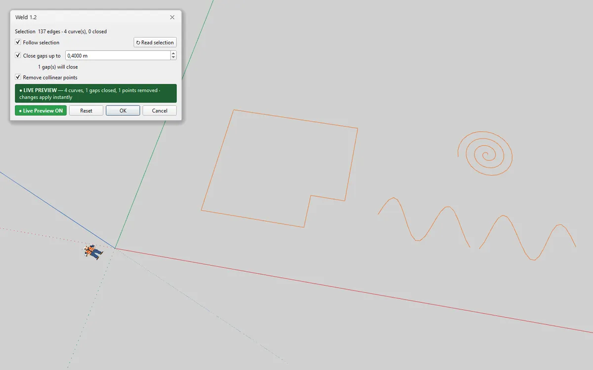

# Weld — Kanten zu Kurven verschweißen für IngeTrazo

Verbindet lose Kanten zu **einer Kurve**, die sich mit einem Klick auswählen lässt — wie ein Kreis oder Bogen — und schließt dabei kleine Lücken. Praktisch für importierte Pläne (DXF/DWG/PDF), deren Umrisse aus Hunderten Einzelsegmenten bestehen.

[English → README.md](README.md)

## Installation
1. In IngeTrazo: **Extensions ▸ Open plugins folder** (Windows: `%APPDATA%\ingetrazo\plugins\`, Linux: `~/.local/share/ingetrazo/plugins/`).
2. `weld_tool.py` in diesen Ordner kopieren.
3. IngeTrazo neu starten → **Extensions ▸ Weld ▸** *Weld Edges… · Unweld Edges* (auch im Rechtsklick-Menü, wenn Kanten gewählt sind).

Benötigt IngeTrazo ≥ 0.5.6 (Extension-API 2) · getestet mit IngeTrazo 0.6.0.

## Bedienung
Kanten auswählen und **Weld Edges…** starten. Jede zusammenhängende Kette wird eine Kurve.

- **Live Preview** (wie in allen PESI3D-Plugins): die verschweißten Kurven stehen sofort im Modell, als ein Undo-Schritt, und folgen jeder Änderung; **OK** übernimmt sie, **Cancel** nimmt sie zurück, **Reset** = Standardwerte. Ohne Vorschau wird der Plan über das Modell gezeichnet — jede künftige Kurve in eigener Farbe, jede Lücke, die sich schließt, in Rot.
- **Follow selection**: bei offenem Dialog andere Kanten wählen, die Vorschau wandert mit; **↻ Read selection** liest die Auswahl sofort.

- **Lücken schließen bis** (Close gaps up to) — verbindet offene Enden, die näher als dieser Abstand liegen (Dokumenteinheit). Zwei freie Enden treffen sich in der Mitte; ein freies Ende neben angebundener Geometrie wird darauf gezogen. Flächen werden nie verschoben.
- **Remove collinear points** — entfernt Zwischenpunkte gerader Abschnitte (nur wo keine Fläche sie nutzt).
- Eine Kette endet an Verzweigungen (drei oder mehr Kanten) und dort, wo andere, nicht gewählte Geometrie anhängt — dieselbe Regel, die IngeTrazo für eigene Kurven nutzt; das Ergebnis bleibt stabil.
- **Unweld Edges** macht gewählte Kurven wieder zu Einzelkanten.
- Ein Undo-Schritt pro Befehl. Der Dialog blockiert den Viewport nicht (Orbit, Pan, Zoom).

## Einheiten
Der Dialog arbeitet in den **Einheiten des geöffneten Dokuments** — eingestellt in IngeTrazo unter **Fenster ▸ Einheiten…** (Strg+U) oder **Fenster ▸ Einstellungen… ▸ Einheiten**:
- Längenfelder zeigen und lesen die Längeneinheit und -form des Dokuments: m, cm, mm, in, ft, Fuß-Zoll (`9'10"`) oder Fuß-Zoll mit Brüchen (`9'10 1/8"`).
- Eingabe mit oder ohne Einheit: `25`, `2,5 cm`, `1'2"`, `3/4"`. Eine Zahl ohne Einheit gilt in der Dokumenteinheit (im Fuß-Zoll-Dokument: Zoll); ein Wert in einer anderen Einheit wird umgerechnet.
- Winkel stehen in der Winkeleinheit des Dokuments (Grad, Radiant oder Gon), Flächen in seiner Flächeneinheit; Prozentfelder und Anzahlen haben keine Einheit. Das Dezimaltrennzeichen folgt dem Dokument — beim Tippen gehen `.` und `,`.
- Ein Wechsel der Einheiten ändert nur Anzeige und Eingabe — das Modell bleibt exakt gleich. Nach dem Ändern den Dialog neu öffnen.
- In IngeTrazo-Versionen vor 0.5.8 sind die Felder einfache Zahlen in Metern.
- **Lücken schließen bis** (Close gaps up to; wie weit Kanten auseinander liegen dürfen, um noch verschweißt zu werden) ist eine Länge in der Dokumenteinheit.

## Änderungen
- **1.3** — **Dokumenteinheiten**: *Close gaps up to* zeigt und liest die Einheiten aus Einstellungen ▸ Einheiten. Getestet mit IngeTrazo 0.6.0.
- **1.2** — die PESI3D-Live-Vorschau: das echte Ergebnis im Modell als ein Undo-Schritt (Knopf *● Live Preview ON*, Banner, *Reset*, *OK* übernimmt die Vorschau, *Cancel* nimmt sie zurück); **Follow selection** und **↻ Read selection**. Getestet mit IngeTrazo 0.5.8.
- **1.1** — eigene Werkzeugleiste **Weld** mit einem Icon je Befehl (Weld Edges… · Unweld Edges). Sie erscheint in einer eigenen Zeile unter den eingebauten Leisten und lässt sich wie diese verschieben, abdocken oder ausblenden (Rechtsklick auf eine Leiste). Icons im Stil von IngeTrazo, passend zum hellen/dunklen Theme.
- **1.0** — erste Veröffentlichung.

## Lizenz
GPL-3.0-or-later · © 2026 Pesi (pesi3d.de) · [Impressum](https://pesi3d.de)
