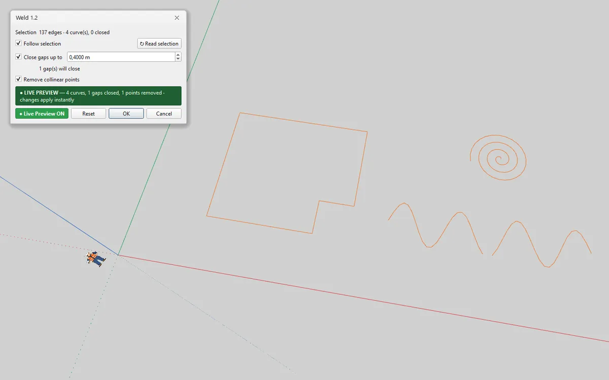

# Weld — join edges into curves for IngeTrazo

Joins loose edges into **one curve** that selects with a single click — like a circle or an arc — and closes small gaps on the way. Handy for imported plans (DXF/DWG/PDF) whose outlines arrive as hundreds of single segments.

[Deutsch → LIESMICH.md](LIESMICH.md)

## Installation
1. In IngeTrazo: **Extensions ▸ Open plugins folder** (Windows: `%APPDATA%\ingetrazo\plugins\`, Linux: `~/.local/share/ingetrazo/plugins/`).
2. Copy `weld_tool.py` into that folder.
3. Restart IngeTrazo → **Extensions ▸ Weld ▸** *Weld Edges… · Unweld Edges* (also on the right-click menu when edges are selected).

Requires IngeTrazo ≥ 0.5.6 (extension API 2) · tested with IngeTrazo 0.6.0.

## How to use
Select the edges and run **Weld Edges…**. Every unbroken chain becomes one curve.

- **Live Preview** (as in every PESI3D plugin): the welded curves stand in the model at once, as one undo step, and follow every change; **OK** keeps them, **Cancel** takes them back, **Reset** = default settings. Preview off, the plan is drawn over the model — each future curve in its own colour, every gap that will close in red.
- **Follow selection**: select other edges while the dialog is open and the preview moves there; **↻ Read selection** reads the selection at once.

- **Close gaps up to** — joins open ends closer than this distance (document unit). Two free ends meet in the middle; a free end next to attached geometry moves onto it. Faces are never moved.
- **Remove collinear points** — drops the extra vertices of straight runs (only where no face uses them).
- A chain stops at junctions (three or more edges) and where other, unselected geometry is attached — the same rule IngeTrazo uses for its own curves, so the result stays stable.
- **Unweld Edges** turns selected curves back into single edges.
- One undo step per command. The dialog does not block the viewport (orbit, pan, zoom).

## Units
The dialog works in the **units of the open document** — set in IngeTrazo under **Window ▸ Units…** (Ctrl+U) or **Window ▸ Preferences… ▸ Units**:
- Length fields show and take the document's length unit and form: m, cm, mm, in, ft, feet-and-inches (`9'10"`) or fractional feet-and-inches (`9'10 1/8"`).
- Type with or without a unit: `25`, `2,5 cm`, `1'2"`, `3/4"`. A number without a unit is in the document's unit (inches in a feet-and-inches document); a value typed in another unit is converted.
- Angles are in the document's angle unit (degrees, radians or gon), areas in its area unit; per-cent fields and counts have no unit. The decimal separator follows the document — `.` and `,` are both accepted when typing.
- Changing the units only changes how values are shown and typed — the model stays exactly as it is. Open the dialog again after changing them.
- On IngeTrazo builds before 0.5.8 the fields are plain numbers in metres.
- **Close gaps up to** (how far apart edges may be and still be welded) is a length in the document's unit.

## Changelog
- **1.3** — **document units**: *Close gaps up to* shows and takes the units of Preferences ▸ Units. Tested with IngeTrazo 0.6.0.
- **1.2** — the PESI3D Live Preview: the real result in the model as one undo step (button *● Live Preview ON*, banner, *Reset*, *OK* keeps the preview, *Cancel* takes it back); **Follow selection** and **↻ Read selection**. Tested with IngeTrazo 0.5.8.
- **1.1** — own toolbar **Weld** with one icon per command (Weld Edges… · Unweld Edges). It starts on a row of its own under the built-in toolbars; move, float or hide it like those (right-click on a toolbar). Icons drawn in IngeTrazo's own style, they follow the light/dark theme.
- **1.0** — first release.

## Licence
GPL-3.0-or-later · © 2026 Pesi (pesi3d.de) · [Impressum](https://pesi3d.de)
